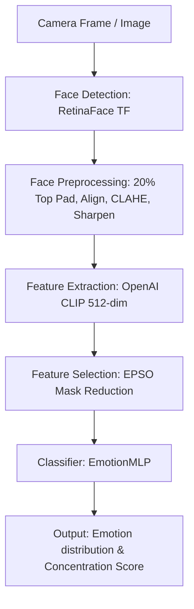

# 🎓 Hệ thống Phân tích Cảm xúc & Mức độ Tập trung (EduFocus AI)

[](https://www.python.org/)
[](https://pytorch.org/)
[](https://fastapi.tiangolo.com/)
[](https://reactjs.org/)

Hệ thống Trí tuệ Nhân tạo (AI) toàn diện được thiết kế để phân tích cảm xúc khuôn mặt theo thời gian thực và đánh giá mức độ tập trung của người dùng trong quá trình học tập. Dự án kết hợp các mô hình Deep Learning tiên tiến (OpenAI CLIP, RetinaFace) cùng thuật toán tối ưu hóa bầy đàn tiến hóa (EPSO) để chọn lọc đặc trưng tốt nhất từ không gian 512 chiều gốc của CLIP.

---

## 🚀 Kiến trúc Hệ thống & Pipeline

Hệ thống thực hiện xử lý tự động theo luồng 5 bước khép kín (End-to-End Inference Pipeline) thời gian thực:



### 1. Nhận diện Khuôn mặt (Face Detection)
Sử dụng mô hình mạng **RetinaFace (TensorFlow)** gốc cho độ chính xác và recall tối đa, tránh hiện tượng bỏ sót khuôn mặt. Trọng số mô hình được thiết kế nạp một lần duy nhất lúc khởi tạo hệ thống (Singleton) giúp giảm độ trễ tối đa.

### 2. Tiền xử lý Khuôn mặt Nâng cao (Face Preprocessing)
*   **Mở rộng vùng biên trên (+20% Top Padding):** Mở rộng khung giới hạn lên phía trên thêm 20% để thu thập toàn bộ trán và tóc, giúp CLIP nhận diện biểu cảm cơ mặt (đặc biệt là nụ cười/Happy) chính xác hơn.
*   **Xoay thẳng trục mặt (Affine Alignment):** Dựa vào tọa độ hai mắt để tính toán góc nghiêng và áp dụng phép biến đổi Affine (`cv2.warpAffine`) đưa khuôn mặt về phương thẳng đứng ($0^\circ$).
*   **Trích xuất tâm số thực (`getRectSubPix`):** Cắt vùng mặt hình vuông bằng tọa độ thực để giữ nguyên chất lượng biên ảnh không bị nhòe do làm tròn pixel.
*   **Xử lý thích ứng độ phân giải (Bilateral Filter + CLAHE + Unsharp Masking):** 
    *   Ảnh nhỏ (<100px) được nâng cấp bằng thuật toán nội suy `Lanczos4` kèm CLAHE lưới nhỏ $4 \times 4$.
    *   Ảnh lớn được lọc khử nhiễu da bằng Bilateral Filter, CLAHE lưới $8 \times 8$ tăng tương phản khối cơ mặt, và làm nét bằng phương pháp trừ Gaussian (Unsharp Masking).

### 3. Trích xuất Đặc trưng (Feature Extraction)
Sử dụng **OpenAI CLIP (ViT-B/32)** làm Feature Extractor lõi. Khác với phiên bản cũ thực hiện nén `AvgPool1d` về 128 chiều gây mất mát thông tin, hệ thống hiện tại **giữ nguyên 512 chiều đặc trưng gốc**, bảo toàn tối đa các đặc trưng ngữ nghĩa tinh tế của cơ mặt.

### 4. Tối ưu Đặc trưng (EPSO Reduction)
Vector 512 chiều đi qua một lớp mặt nạ (mask) được tối ưu hóa bằng thuật toán bầy đàn tiến hóa **EPSO (Evolutionary Particle Swarm Optimization)** để lọc ra tập con đặc trưng nhạy cảm nhất (khoảng 60 - 65 chiều), giúp tăng tốc độ suy luận và loại bỏ đặc trưng nhiễu.

### 5. Phân loại Cảm xúc & Tập trung (Classification & Analysis)
*   **EmotionMLP:** Vector đặc trưng rút gọn đi qua mạng nơ-ron đa lớp (`fc -> batchnorm -> LeakyReLU -> dropout`) để phân loại 8 cảm xúc cơ bản.
*   **Đánh giá sự tập trung (Concentration Score):** Mức độ tập trung được tính toán động dựa vào phân phối xác suất cảm xúc và độ tự tin (confidence) của mô hình.

---

## 🔬 Kỹ thuật Huấn luyện Nâng cao (train_epso.py)

Mô hình phân loại `EmotionMLP` được huấn luyện bằng các kỹ thuật tối ưu hóa SOTA nhằm đạt cực tiểu toàn cục (Global Minima) và khả năng tổng quát hóa cao:

> [!TIP]
> **Curriculum Learning (Học theo giáo trình):**
> *   **Giai đoạn 1 (Epoch 1-50):** Huấn luyện trên dữ liệu sạch (`Clean`) không nhiễu để mô hình học sườn bài toán.
> *   **Giai đoạn 2 (Epoch 51-150):** Bắt đầu "đeo tạ nhẹ" (`Light`) bằng việc kích hoạt nhiễu Gaussian nhẹ (0.005) và Mixup nhẹ (0.1).
> *   **Giai đoạn 3 (Epoch 151+):** "Đeo tạ nặng" (`Full`) với nhiễu 0.01 và Mixup 0.2 để rèn luyện khả năng chống overfitting.

> [!NOTE]
> **Warm-up + Cosine Annealing Warm Restarts:**
> *   Áp dụng **Linear Warm-up** trong 5 epoch đầu để đưa LR tăng dần từ 1% lên mức mục tiêu `0.0003`, tránh phá vỡ trọng số khi khởi tạo ngẫu nhiên.
> *   Sử dụng **CosineAnnealingWarmRestarts** chu kỳ $T_0=25$ (nhân đôi sau mỗi chu kỳ) giúp Learning Rate giảm rồi đột ngột nhảy vọt lên để "bật" ra khỏi các cực tiểu địa phương (Local Minima).
> *   Kết hợp **Gradient Clipping** giới hạn tối đa `max_norm=1.0` giúp mô hình di chuyển thận trọng, len lỏi tìm điểm hội tụ sâu nhất.

---

## 🛠 Công nghệ Sử dụng

*   **Frontend:** React.js, TailwindCSS, Vite, Lucide React (Giao diện Premium, tối ưu trải nghiệm tương tác trực quan)
*   **Backend:** FastAPI (Server bất đồng bộ hiệu năng cao)
*   **AI Core:** PyTorch (Hỗ trợ GPU CUDA), OpenCV, TensorFlow (chạy RetinaFace), Scikit-Learn

---

## 📁 Cấu trúc Thư mục

```text
Emotion_Concentration/
├── backend/
│   ├── data/                 # Thư mục chứa dữ liệu ảnh gốc (Train/Test)
│   │   ├── Train/
│   │   ├── Test/
│   │   ├── extracted_features/ # Vector đặc trưng .pt (512-dim) của từng ảnh
│   │   └── labels.csv        # File nhãn ảnh định dạng CSV
│   ├── models/
│   │   ├── epso.py           # Thuật toán tối ưu bầy đàn EPSO
│   │   └── mlp.py            # Mạng nơ-ron phân loại EmotionMLP
│   ├── main.py               # FastAPI Server điều phối API
│   ├── pipeline.py           # Luồng suy luận thời gian thực (Inference Pipeline)
│   ├── preprocess_features.py# Script trích xuất ảnh sang vector đặc trưng 512 chiều
│   ├── train_epso.py         # Script tối ưu EPSO & huấn luyện EmotionMLP
│   ├── dataset_cache.npz     # Cache nén tập dữ liệu giúp nạp dữ liệu siêu tốc
│   ├── epso_mask_real.npy    # Mặt nạ đặc trưng tìm được bởi EPSO (chứa các index được chọn)
│   ├── emotion_mlp_epso_weights.pth # Trọng số MLP tốt nhất theo Val Loss
│   └── emotion_mlp_best_acc_weights.pth # Trọng số MLP tốt nhất theo Val Accuracy
├── frontend/                 # Source code giao diện React
└── README.md                 # Tài liệu hướng dẫn dự án
```

---

## ⚙️ Hướng dẫn Cài đặt & Khởi chạy

### 1. Yêu cầu Hệ thống
*   Python 3.9+
*   Node.js 18+
*   Khuyến nghị GPU NVIDIA có hỗ trợ CUDA.

### 2. Cài đặt Backend
```bash
cd backend
python -m venv venv

# Kích hoạt môi trường ảo:
# Windows (PowerShell):
.\venv\Scripts\activate
# Linux/macOS:
source venv/bin/activate

# Cài đặt PyTorch hỗ trợ GPU CUDA (Ví dụ bản CUDA 12.1):
pip install torch torchvision torchaudio --index-url https://download.pytorch.org/whl/cu121

# Cài đặt các thư viện phụ thuộc:
pip install fastapi uvicorn opencv-python pandas tqdm scikit-learn clip python-multipart retinaface matplotlib
```

### 3. Cài đặt Frontend
```bash
cd ../frontend
npm install
```

### 4. Chạy Ứng dụng
Khởi chạy đồng thời 2 Terminal:

*   **Terminal 1 (AI Backend Server):**
    ```bash
    cd backend
    .\venv\Scripts\activate
    uvicorn main:app --reload
    ```
*   **Terminal 2 (React Frontend Dashboard):**
    ```bash
    cd frontend
    npm run dev
    ```

---

## 🧠 Quy trình Huấn luyện lại từ đầu

Nếu bạn có tập dữ liệu mới hoặc muốn huấn luyện lại mô hình với các thay đổi mới:

1.  **Dọn dẹp cache cũ:**
    Xóa file `dataset_cache.npz`, `epso_mask_real.npy` và thư mục `backend/data/extracted_features` để dọn đường cho quá trình trích xuất mới.
2.  **Chạy trích xuất đặc trưng mới (512 chiều, có 20% Top Padding):**
    Thiết lập `force_reextract=True` ở cuối file [preprocess_features.py](file:///d:/Emotion_Concentration/backend/preprocess_features.py) và chạy:
    ```bash
    python preprocess_features.py
    ```
3.  **Chạy thuật toán EPSO & Huấn luyện MLP:**
    ```bash
    python train_epso.py
    ```
    *Sau khi hoàn tất, hệ thống sẽ:*
    - Tạo tệp `dataset_cache.npz` giúp tăng tốc độ tải dữ liệu cho các lần chạy sau.
    - Tìm và lưu mặt nạ tối ưu `epso_mask_real.npy`.
    - Huấn luyện `EmotionMLP` và lưu trọng số tốt nhất vào `emotion_mlp_epso_weights.pth`.
    - In ra bảng Confusion Matrix trên console và lưu biểu đồ heatmap trực quan tại `backend/confusion_matrix.png`.

---

## 📝 Giấy phép
Dự án được xây dựng phục vụ mục đích nghiên cứu, phát triển công nghệ AI hỗ trợ giáo dục và phân tích hành vi trực tuyến.
