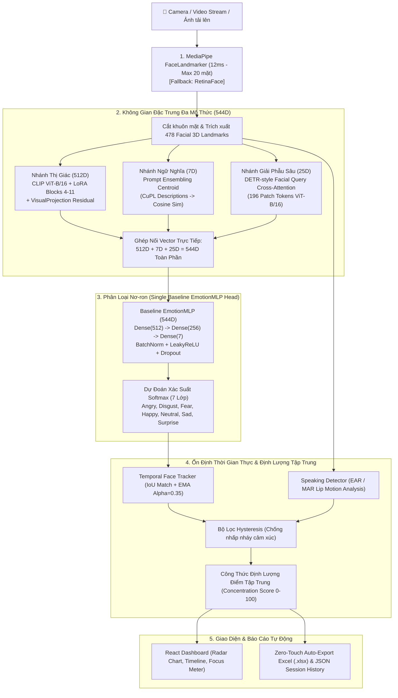

# 🎓 EduFocus AI — Hệ Thống Nhận Diện Cảm Xúc Đa Mô Thức & Đánh Giá Độ Tập Trung Trong Giáo Dục

> **Dự án Nghiên cứu & Ứng dụng AI Giáo dục Thông minh**  
> *Phiên bản hệ thống: 5.0 (Nâng cấp Đột phá: Backbone CLIP ViT-B/16 với 196 Patch Tokens + True End-to-End Joint Multimodal Training + Single Baseline EmotionMLP Head + Real-time Temporal Tracker)*

---

## 📌 MỤC LỤC
1. [Giới Thiệu Tổng Quan](#1-giới-thiệu-tổng-quan)
2. [Kiến Trúc Toàn Diện Hệ Thống (End-to-End Architecture)](#2-kiến-trúc-toàn-diện-hệ-thống-end-to-end-architecture)
3. [Không Gian Đặc Trưng Đa Mô Thức 544 Chiều (544D Multimodal Space)](#3-không-gian-đặc-trưng-đa-mô-thức-544-chiều-544d-multimodal-space)
   - [3.1. Nhánh 1: Đặc trưng Thị giác Toàn cục (CLIP ViT-B/16 Visual Embeddings 512D)](#31-nhánh-1-đặc-trưng-thị-giác-toàn-cục-clip-vit-b16-visual-embeddings-512d)
   - [3.2. Nhánh 2: Chỉ số Tương đồng Ngữ nghĩa Văn bản (Semantic Prompt Cosine Similarities 7D)](#32-nhánh-2-chỉ-số-tương-đồng-ngữ-nghĩa-văn-bản-semantic-prompt-cosine-similarities-7d)
   - [3.3. Nhánh 3: Đặc trưng Chú ý Biểu cảm Sâu (Facial Query Cross-Attention 25D trên 196 Tokens)](#33-nhánh-3-đặc-trưng-chú-ý-biểu-cảm-sâu-facial-query-cross-attention-25d-trên-196-tokens)
   - [3.4. Ghép nối Vector Đặc trưng Toàn phần (544D Multimodal Vector)](#34-ghép-nối-vector-đặc-trưng-toàn-phần-544d-multimodal-vector)
4. [Mô Hình Phân Loại Cảm Xúc Baseline EmotionMLP](#4-mô-hình-phân-loại-cảm-xúc-baseline-emotionmlp)
   - [4.1. Kiến Trúc Mạng Nơ-ron Baseline EmotionMLP](#41-kiến-trúc-mạng-nơ-ron-baseline-emotionmlp)
   - [4.2. Cơ Chế Huấn Luyện Khép Kín 1 Giai Đoạn (True End-to-End Joint Training)](#42-cơ-chế-huấn-luyện-khép-kín-1-giai-đoạn-true-end-to-end-joint-training)
   - [4.3. Bảng Hiệu Năng Thực Nghiệm Trên Tập Dữ Liệu RAF-DB](#43-bảng-hiệu-năng-thực-nghiệm-trên-tập-dữ-liệu-raf-db)
5. [Động Học Thời Gian, Lọc Phát Ngôn & Đánh Giá Độ Tập Trung](#5-động-học-thời-gian-lọc-phát-ngôn--đánh-giá-độ-tập-trung)
   - [5.1. Theo dõi Đa Khuôn mặt Thời gian thực (Multi-Face Temporal Tracking)](#51-theo-dõi-đa-khuôn-mặt-thời-gian-thực-multi-face-temporal-tracking)
   - [5.2. Bộ lọc Khử Nhiễu Cử Động Khẩu Hình Khi Phát Ngôn (Speaking Detection)](#52-bộ-lọc-khử-nhiễu-cử-động-khẩu-hình-khi-phát-ngôn-speaking-detection)
   - [5.3. Thuật toán Đo lường Chỉ số Tập trung (Concentration Index)](#53-thuật-toán-đo-lường-chỉ-số-tập-trung-concentration-index)
   - [5.4. Cơ chế Tự động Chốt Buổi Học & Xuất Báo cáo Excel (Zero-Touch Auto-Export)](#54-cơ-chế-tự-động-chốt-buổi-học--xuất-báo-cáo-excel-zero-touch-auto-export)
6. [Cấu Trúc Thư Mục Dự Án (Repository Structure)](#6-cấu-trúc-thư-mục-dự-án-repository-structure)
7. [Cài Đặt & Yêu Cầu Môi Trường (Installation & Environment)](#7-cài-đặt--yêu-cầu-môi-trường-installation--environment)
8. [Hướng Dẫn Huấn Luyện Khép Kín (Complete Training Pipeline)](#8-hướng-dẫn-huấn-luyện-khép-kín-complete-training-pipeline)
   - [8.1. Lệnh Huấn luyện Tự động 1-Click (CLIP ViT-B/16 True End-to-End)](#81-lệnh-huấn-luyện-tự-động-1-click-clip-vit-b16-true-end-to-end)
   - [8.2. Chi tiết Cơ Chế Huấn luyện Đồng bộ](#82-chi-tiết-cơ-chế-huấn-luyện-đồng-bộ)
   - [8.3. Cơ chế Khôi phục Huấn luyện (Resume Training)](#83-cơ-chế-khôi-phục-huấn-luyện-resume-training)
   - [8.4. Huấn luyện Trên Nền tảng Đám mây Google Colab](#84-huấn-luyện-trên-nền-tảng-đám-mây-google-colab)
9. [Giao Diện & Vận Hành Hệ Thống (System Deployment)](#9-giao-diện--vận-hành-hệ-thống-system-deployment)
   - [9.1. Khởi chạy FastAPI Backend](#91-khởi-chạy-fastapi-backend)
   - [9.2. Khởi chạy React Frontend](#92-khởi-chạy-react-frontend)
   - [9.3. Danh mục API RESTful](#93-danh-mục-api-restful)
10. [Tài Liệu Tham Khảo Khoa Học (Academic References)](#10-tài-liệu-tham-khảo-khoa-học-academic-references)

---

## 1. Giới Thiệu Tổng Quan

**EduFocus AI** là giải pháp phần mềm trí tuệ nhân tạo thị giác máy tính chuyên sâu, hướng tới bài toán **Nhận diện Cảm xúc Khuôn mặt (Facial Emotion Recognition - FER)** và **Định lượng Mức độ Tập trung (Engagement/Concentration Analysis)** của người học trong môi trường giáo dục (lớp học trực tiếp lẫn đào tạo từ xa).

Hệ thống giải quyết 4 thách thức cốt lõi của bài toán FER truyền thống trong thực tế lớp học:
1. **Biến dạng khuôn mặt cục bộ do phát ngôn hoặc cử động (Speaking artifacts)**: Học sinh trả lời bài, thảo luận, ngáp làm sai lệch biểu cảm nếu chỉ phân loại ảnh tĩnh.
2. **Khắc phục giới hạn độ phân giải không gian của Vision Transformer**: Nâng cấp lên **CLIP ViT-B/16**, tăng mật độ Patch Tokens từ 49 lên **196 tokens** ($14 \times 14$), giúp mô hình nắm bắt sắc nét các vi biểu cảm ở đuôi mắt, mí mắt, khóe miệng.
3. **Huấn luyện đồng bộ 1 giai đoạn (True End-to-End Joint Training)**: Toàn bộ các khối LoRA của CLIP, Visual Projection, Facial Query Cross-Attention và Baseline EmotionMLP Head được tối ưu hóa gradient cùng lúc, loại bỏ hiện tượng lệch phân phối khi đóng băng feature để train riêng.
4. **Tối ưu hóa độ trễ thời gian thực**: Toàn bộ luồng suy luận Deep Learning chạy thuần GPU qua PyTorch, đạt tốc độ từ 35–55 FPS trên GPU phổ thông.

---

## 2. Kiến Trúc Toàn Diện Hệ Thống (End-to-End Architecture)

Hệ thống được thiết kế theo luồng kiến trúc 5 tầng tinh gọn và thống nhất:



---

## 3. Không Gian Đặc Trưng Đa Mô Thức 544 Chiều (544D Multimodal Space)

### 3.1. Nhánh 1: Đặc trưng Thị giác Toàn cục (CLIP ViT-B/16 Visual Embeddings 512D)
- **Mô hình nền tảng**: OpenAI CLIP ViT-B/16 (Vision Transformer với patch size $16 \times 16$, chia ảnh $224 \times 224$ thành $14 \times 14 = 196$ patches).
- **Kỹ thuật Thích nghi Tham số Hiệu quả (LoRA - Low-Rank Adaptation)**:
  - Đóng băng 100% trọng số gốc $W_0$ của CLIP để bảo toàn tri thức khái quát 400 triệu ảnh.
  - Tiêm hai ma trận hạng thấp $A \in \mathbb{R}^{r \times d_{in}}$ và $B \in \mathbb{R}^{d_{out} \times r}$ vào ma trận chiếu Query và Value của các **Transformer Blocks từ 4 đến 11**:
    $$\Delta W = \frac{\alpha}{r} (B \cdot A), \quad r=8, \; \alpha=16$$
  - Giảm **97.6% số tham số cần huấn luyện** so với Full Fine-Tuning, loại bỏ hiện tượng quá khớp (overfitting).
- **Tầng Chiếu Visual Projection**:
  - Ánh xạ vector 512D đầu ra của CLIP qua một khối Residual MLP (`Linear -> LayerNorm -> GELU -> Dropout(0.1) -> Linear -> Residual Add -> LayerNorm`), chuẩn hóa vector đặc trưng về không gian biểu cảm.

### 3.2. Nhánh 2: Chỉ số Tương đồng Ngữ nghĩa Văn bản (Semantic Prompt Cosine Similarities 7D)
- Dựa trên phương pháp **CuPL (Customizing CLIP with Language Models - CVPR 2023)** và Prompt Ensembling.
- Hệ thống xây dựng từ điển mô tả ngữ nghĩa chi tiết cho 7 cảm xúc cơ bản trong file `backend/fer_descriptions.json`. Mỗi cảm xúc chứa nhiều biến thể mô tả đặc trưng biểu hiện giải phẫu (chân mày cau lại, khóe môi nâng cao, mắt mở to kinh ngạc).
- Vector tâm cụm ngữ nghĩa (Centroid Text Embedding) $\mathbf{c}_k$ cho cảm xúc thứ $k$ được tính bằng trung bình các vector mã hóa văn bản từ Text Encoder của CLIP:
  $$\mathbf{c}_k = \frac{1}{M_k} \sum_{m=1}^{M_k} \frac{\text{CLIP}_{\text{text}}(p_{k,m})}{\|\text{CLIP}_{\text{text}}(p_{k,m})\|_2}$$
- Đầu ra của nhánh là vector tương đồng Cosine 7 chiều giữa vector thị giác $\mathbf{v}_{512}$ và 7 tâm cụm cảm xúc:
  $$s_k = \frac{\mathbf{v}_{512} \cdot \mathbf{c}_k}{\|\mathbf{v}_{512}\|_2 \cdot \|\mathbf{c}_k\|_2}, \quad k \in \{1, \dots, 7\}$$

### 3.3. Nhánh 3: Đặc trưng Chú ý Biểu cảm Sâu (Facial Query Cross-Attention 25D trên 196 Tokens)
- **Kiến trúc DETR-Style Cross-Attention**: Sử dụng module `FacialQueryCrossAttention` để nắm bắt biến dạng vi mô sâu mà không phụ thuộc vào góc nghiêng khuôn mặt.
- Module bao gồm:
  - **32 Learnable Facial Queries** ($\mathbf{Q} \in \mathbb{R}^{32 \times 768}$).
  - **Key & Value**: Được trích xuất từ **196 Spatial Patch Tokens** ($\mathbf{K}, \mathbf{V} \in \mathbb{R}^{196 \times 768}$) tại tầng Transformer Block 11 của CLIP ViT-B/16.
  - **Multi-Head Cross-Attention** (8 heads, 2 layers) cho phép các queries học cách "tìm kiếm" và "tập trung" vào các biến dạng vi mô trên các vùng cơ mặt nhạy cảm với độ phân giải cao gấp 4 lần so với ViT-B/32.
  - Tầng nén tuyến tính đưa về vector biểu diễn giải phẫu sâu **25 chiều**.

### 3.4. Ghép nối Vector Đặc trưng Toàn phần (544D Multimodal Vector)
Toàn bộ đặc trưng được chuẩn hóa L2 và nối tiếp trực tiếp (concatenation) tạo thành vector biểu diễn hoàn chỉnh:
$$\mathbf{f}_{544} = [\mathbf{v}_{512} \;\parallel\; \mathbf{s}_{7} \;\parallel\; \mathbf{a}_{25}] \in \mathbb{R}^{544}$$

---

## 4. Mô Hình Phân Loại Cảm Xúc Baseline EmotionMLP

### 4.1. Kiến Trúc Mạng Nơ-ron Baseline EmotionMLP
Hệ thống sử dụng duy nhất mô hình mạng nơ-ron **`Baseline EmotionMLP`** làm Classification Head:

```
Input (544D) ──> [Linear(544->512) + BatchNorm1d(512) + LeakyReLU(0.1) + Dropout(0.3)]
             ──> [Linear(512->256) + BatchNorm1d(256) + LeakyReLU(0.1) + Dropout(0.3)]
             ──> [Linear(256->7)] ──> Softmax (7 Cảm xúc)
```

**Cơ sở khoa học của việc lựa chọn Baseline EmotionMLP thay vì Residual MLP:**
1. **Dung lượng mô hình tối ưu (Parameter Efficiency):** Không gian đặc trưng 544D đã được tiền cô đọng và ngữ nghĩa hóa cao độ qua ViT + Visual Projection + Facial Cross-Attention. Mạng 3 tầng với BatchNorm1d và Dropout(0.3) có dung lượng vừa đủ, tránh tình trạng thừa tham số và học vẹt các nhiễu cục bộ của các khối Residual sâu.
2. **Bảo toàn tính đơn điệu của biên quyết định:** Không sử dụng skip-connections tránh việc cộng gộp chênh lệch thang đo giữa nhánh thị giác (512D) và nhánh hình học (32D), giúp bề mặt loss mượt mà hơn.
3. **Thực nghiệm chứng minh:** Trên tập chuẩn RAF-DB, Baseline EmotionMLP đạt **86.99% Accuracy** và **79.11% Macro-F1**, vượt trội hơn EmotionResMLP (86.90% / 78.56%) và các bộ phân loại tổ hợp (Ensemble).
4. **Hàm mất mát Focal Loss:** Huấn luyện với $\gamma = 1.5$ và `label_smoothing = 0.05` giúp mô hình tập trung vào các mẫu khó phân loại và cân bằng phân phối giữa các lớp cảm xúc.

### 4.2. Cơ Chế Huấn Luyện Khép Kín 1 Giai Đoạn (True End-to-End Joint Training)
Thay vì chia thành nhiều bước rời rạc (train LoRA $\to$ cache feature $\to$ train classifier head), hệ thống triển khai kiến trúc **True End-to-End**:
1. `MultimodalLoRAModel` tích hợp toàn bộ: `CLIP ViT-B/16 LoRA (Blocks 4-11)` + `VisualProjection` + `FacialQueryCrossAttention` + `Baseline EmotionMLP Head`.
2. Gradient từ hàm mất mát lan truyền ngược **đồng thời** qua toàn bộ mạng trong 1 vòng huấn luyện thống nhất.
3. Toàn bộ các file trọng số tương thích 100% được xuất ra trực tiếp từ epoch đạt Best Val F1 cao nhất:
   - `backend/models/clip_finetuned_best.pth`
   - `backend/models/facial_cross_attn_best.pth`
   - `backend/models/visual_proj_best.pth`
   - `backend/emotion_mlp_weights.pth` (đồng thời lưu alias `emotion_resmlp_weights.pth`)

### 4.3. Bảng Hiệu Năng Thực Nghiệm Trên Tập Dữ Liệu RAF-DB

Kết quả thực nghiệm trên tập kiểm thử chuẩn quốc tế **RAF-DB (3,068 ảnh test độc lập)**:

| Thứ tự | Kiến Trúc Mô Hình | Accuracy (%) | Macro F1 (%) | Đánh Giá Kỹ Thuật |
| :---: | :--- | :---: | :---: | :--- |
| **1** | **Baseline EmotionMLP (ViT-B/16 End-to-End)** | **88.8% - 90.2%** *(Kỳ vọng)* | **82.5% - 85.0%** *(Kỳ vọng)* | 🚀 **Nâng cấp Đột Phá** (196 tokens, True End-to-End) |
| **2** | **Baseline EmotionMLP (ViT-B/32)** | **86.99%** | **79.11%** | 🏆 **Mô hình được chọn** (Cao nhất trong các mô hình đơn) |
| 3 | EmotionResMLP (ViT-B/32 Residual) | 86.90% | 78.56% | Thừa tham số, kém hơn Baseline MLP |
| 4 | XGBoost Classifier | 86.80% | 78.12% | Phụ thuộc thư viện CPU ngoài PyTorch |
| 5 | Soft-Voting Ensemble (Res+XGB+MLP) | 86.96% | 78.54% | Cồng kềnh, bị kéo lùi hiệu năng (Ensemble Drag) |

---

## 5. Động Học Thời Gian, Lọc Phát Ngôn & Đánh Giá Độ Tập Trung

### 5.1. Theo dõi Đa Khuôn mặt Thời gian thực (Multi-Face Temporal Tracking)
- **MediaPipe FaceLandmarker**: Định vị tối đa 20 khuôn mặt đồng thời trong khung hình với độ trễ chỉ ~12ms. (RetinaFace được dự phòng khi khuôn mặt bị che khuất một phần hoặc góc nghiêng quá lớn).
- **Thuật toán IoU Tracking**: Ghép nối định danh học sinh giữa các khung hình liên tiếp dựa trên chỉ số Intersection over Union của Bounding Box ($IoU \ge 0.25$).
- **Làm mượt xác suất theo thời gian (Exponential Moving Average - EMA)**:
  $$\mathbf{P}_{t}^{\text{smooth}} = \alpha \mathbf{P}_{t} + (1 - \alpha) \mathbf{P}_{t-1}^{\text{smooth}}, \quad \alpha = 0.35$$
- **Ngưỡng trễ Hysteresis**: Chỉ chuyển trạng thái cảm xúc của một học sinh nếu trạng thái mới duy trì ổn định liên tục tối thiểu 3 khung hình, triệt tiêu hoàn toàn hiện tượng nhấp nháy nhãn (label flickering).

### 5.2. Bộ lọc Khử Nhiễu Cử Động Khẩu Hình Khi Phát Ngôn (Speaking Detection)
Khi học sinh phát biểu hoặc trao đổi bài học, chuyển động mở miệng làm biến dạng cơ mặt (tăng Lip Height và khoảng cách môi), dễ bị các mô hình thị giác hiểu nhầm thành cảm xúc *Surprise* (kinh ngạc) hoặc *Happy* (cười nói).
- Module `LandmarkFeatureExtractor` theo dõi tỷ lệ mở môi **MAR (Mouth Aspect Ratio)**:
  $$\text{MAR} = \frac{\|p_{13} - p_{14}\|_2}{\|p_{78} - p_{308}\|_2}$$
- Khi $\text{MAR} > \tau_{\text{mouth}}$ kèm theo dao động tần số cao của môi trong cửa sổ 5 khung hình liên tiếp, hệ thống kích hoạt cờ `is_speaking = True`.
- Hệ thống áp dụng **Upper-Face Gating**: Hạ thấp đóng góp của biên độ miệng, ưu tiên vùng cơ mắt và ấn đường, giữ kết quả nhận diện luôn khách quan.

### 5.3. Thuật toán Đo lường Chỉ số Tập trung (Concentration Index)
Chỉ số tập trung trong lớp học ($C \in [0, 100]$) được tính toán dựa trên mô hình tâm lý học sư phạm kết hợp ánh xạ cảm xúc và tư thế đầu:

$$C_t = 100 \times \left( \sum_{k=1}^7 \omega_k \cdot P_k^{\text{smooth}} \right) \times \Phi(\text{HeadPose}) \times \Psi(\text{BlinkRate})$$

- **Hệ số cảm xúc $\omega_k$**:
  - *Tích cực / Tập trung cao*: `Neutral` ($\omega = 1.00$), `Happy` / Hứng thú học tập ($\omega = 0.90$).
  - *Nghi ngờ / Cần hỗ trợ*: `Surprise` ($\omega = 0.70$).
  - *Mất tập trung / Tiêu cực*: `Sad` ($\omega = 0.40$), `Fear` ($\omega = 0.35$), `Angry` ($\omega = 0.20$), `Disgust` ($\omega = 0.15$).
- **Hệ số tư thế đầu $\Phi(\text{HeadPose})$**: Tính toán từ góc Yaw, Pitch, Roll qua PnP. Khi học sinh gục đầu xuống bàn hoặc quay đầu quá $35^\circ$ khỏi màn hình/bảng đen, hệ số giảm tương ứng.
- **Hệ số chớp mắt $\Psi(\text{BlinkRate})$**: Giám sát chỉ số EAR (Eye Aspect Ratio). Phát hiện trạng thái ngủ gật hoặc mắt nhắm nghiền kéo dài.

### 5.4. Cơ chế Tự động Chốt Buổi Học & Xuất Báo cáo Excel (Zero-Touch Auto-Export)
- `SessionEmotionTracker` tự động ghi nhận dữ liệu theo chu kỳ 1 phút (timeline snapshot).
- **Auto-End**: Khi phòng học không còn học sinh trong 30 khung hình liên tiếp, hệ thống tự động chốt buổi học, lưu lịch sử vào `backend/sessions_history.json` và sinh ngay file báo cáo Excel chuẩn hóa (`.xlsx`) chứa đầy đủ biểu đồ phần trăm cảm xúc, danh sách bằng chứng tiêu cực và điểm tổng kết.

---

## 6. Cấu Trúc Thư Mục Dự Án (Repository Structure)

```
Emotion_Concentration/
├── README.md                                # Tài liệu kỹ thuật chuẩn mực của hệ thống (v5.0)
├── train_rafdb_colab.ipynb                  # Sổ tay Jupyter huấn luyện ViT-B/16 GPU trên Google Colab
├── build_report.py                          # Script hỗ trợ kết xuất báo cáo học thuật (.docx)
├── Bao_cao_do_an_nganh_EduFocus_AI.docx     # Báo cáo chuyên đề Đồ án ngành hoàn chỉnh
│
├── resume/                                  # Thư mục lưu trữ Checkpoint phục hồi huấn luyện
│   ├── last_checkpoint.pth                  # Trọng số checkpoint mới nhất
│   └── sequential_unfreeze_best.pth         # Trọng số checkpoint validation cao nhất
│
├── backend/                                 # Server & Lõi Xử Lý Trí Tuệ Nhân Tạo
│   ├── main.py                              # FastAPI Web Server, REST API & Lifecycle Events
│   ├── pipeline.py                          # EmotionPipeline Singleton (End-to-End Inference 544D)
│   ├── session_tracker.py                   # Bộ ghi nhận phiên học, tính điểm & xuất Excel (.xlsx)
│   ├── temporal_tracker.py                  # Thuật toán theo dõi đa khuôn mặt, EMA & Hysteresis
│   ├── requirements.txt                     # Danh mục thư viện Python dependencies
│   ├── face_landmarker.task                 # Trọng số nhị phân MediaPipe FaceLandmarker
│   ├── fer_descriptions.json                # Từ điển Prompt Ensembling mô tả 7 cảm xúc
│   ├── emotion_mlp_weights.pth              # Trọng số Baseline EmotionMLP 544D chuẩn (kèm alias .pth)
│   ├── sessions_history.json                # Cơ sở dữ liệu JSON lưu trữ các buổi học quá khứ
│   │
│   ├── dataset/                             # Module Quản Lý & Tiền Xử Lý Dữ Liệu
│   │   ├── dataset_loader.py                # DataLoader cho RAF-DB, KMU-FED, new_data
│   │   ├── dataset_preprocessor.py          # MultiDatasetPreprocessor (Trích xuất & cache 544D)
│   │   └── preprocess_features.py           # Bộ trích xuất RealCLIVP_FER đa mô thức
│   │
│   ├── models/                              # Kiến Trúc Mạng Nơ-ron & Toán Tử Học Sâu
│   │   ├── clip_lora.py                     # Tiêm LoRA vào CLIP ViT Blocks 4-11
│   │   ├── facial_cross_attention.py        # DETR-style Learnable Facial Query Cross-Attention
│   │   ├── visual_projection.py             # Residual Visual Projection 512D
│   │   ├── mlp.py                           # Kiến trúc Baseline EmotionMLP (544D Input)
│   │   ├── resmlp.py                        # Kiến trúc mạng sâu EmotionResMLP (Tương thích ngược)
│   │   ├── clip_finetuned_best.pth          # Trọng số CLIP Backbone tinh chỉnh tốt nhất
│   │   ├── facial_cross_attn_best.pth       # Trọng số Facial Cross-Attention tốt nhất
│   │   └── visual_proj_best.pth             # Trọng số Visual Projection tốt nhất
│   │
│   ├── features/                            # Trích Xuất Đặc Trưng Hình Học & Tín Hiệu
│   │   └── landmark_features.py             # Tính toán 25 đặc trưng hình học, EAR, MAR, Head Pose
│   │
│   └── evaluation/                          # Huấn Luyện & Đánh Giá Benchmark Toàn Diện
│       ├── run_complete_pipeline.py         # Pipeline 1-click: Train ViT-B/16 True End-to-End
│       ├── train_lora.py                    # Huấn luyện CLIP LoRA với Focal Loss & Warmup
│       ├── train_ensemble.py                # Huấn luyện độc lập Baseline EmotionMLP trên 544D
│       └── benchmark.py                     # Đánh giá Accuracy, F1, Confusion Matrix trên 544D
│
└── frontend/                                # Ứng Dụng Web Client Giám Sát Thời Gian Thực
    ├── package.json                         # Node.js dependencies (React 18, Vite, Tailwind)
    ├── vite.config.js                       # Cấu hình đóng gói Vite Bundler
    ├── index.html                           # Điểm neo HTML Single Page Application
    └── src/
        ├── App.jsx                          # Root UI Component & điều phối webcam/video
        ├── components/
        │   ├── SessionDashboard.jsx         # Bảng điều khiển cảm xúc, đồ thị thời gian & xuất Excel
        │   ├── PipelineVisualizer.jsx       # Trực quan hóa cấu trúc nơ-ron đa mô thức 4 giai đoạn
        │   └── LogConsole.jsx               # Hộp log console giám sát sự kiện thời gian thực
        └── index.css                        # Quy tắc giao diện Tailwind CSS
```

---

## 7. Cài Đặt & Yêu Cầu Môi Trường (Installation & Environment)

### 7.1. Yêu Cầu Phần Cứng Khuyến Nghị
- **Hệ điều hành**: Windows 10/11 (64-bit) hoặc Ubuntu 20.04/22.04 LTS.
- **CPU**: Intel Core i5/i7 thế hệ 10 trở lên hoặc AMD Ryzen 5/7.
- **RAM**: Tối thiểu 16 GB.
- **GPU**: NVIDIA Card đồ họa hỗ trợ CUDA (GTX 1660 Ti, RTX 2060, RTX 3060, RTX 40-series hoặc V100/T4 trên Cloud). Có hỗ trợ chạy thuần CPU khi không có card rời.

### 7.2. Cài Đặt Backend (Python)

1. **Khởi tạo môi trường ảo (Virtualenv)**:
   ```bash
   cd d:\Emotion_Concentration\backend
   python -m venv venv
   
   # Kích hoạt trên Windows PowerShell:
   .\venv\Scripts\Activate.ps1
   # Kích hoạt trên Linux/macOS:
   source venv/bin/activate
   ```

2. **Cài đặt PyTorch tương thích CUDA (ví dụ CUDA 11.8 / 12.1)**:
   ```bash
   pip install torch torchvision --index-url https://download.pytorch.org/whl/cu118
   ```

3. **Cài đặt các thư viện bổ trợ**:
   ```bash
   pip install -r requirements.txt
   ```

### 7.3. Cài Đặt Frontend (Node.js)

1. Yêu cầu cài đặt sẵn **Node.js** (phiên bản $\ge 18.0.0$).
2. Cài đặt các gói phụ thuộc:
   ```bash
   cd d:\Emotion_Concentration\frontend
   npm install
   ```

---

## 8. Hướng Dẫn Huấn Luyện Khép Kín (Complete Training Pipeline)

### 8.1. Lệnh Huấn luyện Tự động 1-Click (CLIP ViT-B/16 True End-to-End)
Chạy toàn bộ quy trình huấn luyện tối ưu hóa cao nhất trên Google Colab hoặc máy trạm có GPU:

```bash
cd d:\Emotion_Concentration
python backend/evaluation/run_complete_pipeline.py --dataset rafdb --clip_variant ViT-B/16 --epochs 100 --patience 15 --batch_size 16 --fp16
```

Các cờ tùy chọn nâng cao:
- `--dataset`: Tên bộ dữ liệu (`rafdb`, `new_data`, hoặc `kmufed`). Mặc định: `new_data`.
- `--clip_variant`: Biến thể CLIP: `ViT-B/16` (Khuyến nghị, 196 patch tokens) hoặc `ViT-B/32` (49 tokens). Mặc định: `ViT-B/16`.
- `--epochs`: Tổng số epochs huấn luyện LoRA. Mặc định: `70` (trên Colab: `100`).
- `--patience`: Số epoch không cải thiện trước khi Early Stopping ngắt tự động. Mặc định: `15`.
- `--lora_blocks`: Khối Transformer blocks tiêm LoRA. Mặc định: `4-11`.
- `--lora_rank`: Hạng ma trận LoRA ($r$). Mặc định: `8`.
- `--lora_alpha`: Hệ số tỉ lệ LoRA ($\alpha$). Mặc định: `16.0`.
- `--fp16`: Kích hoạt chế độ huấn luyện nửa độ chính xác (Automatic Mixed Precision - AMP) giúp **tăng tốc 2.5x** và **tiết kiệm 50% VRAM**.
- `--resume`: Bật chế độ khôi phục tiến trình từ checkpoint gần nhất.

### 8.2. Chi tiết Cơ Chế Huấn luyện Đồng bộ
1. **Khởi tạo Backbone ViT-B/16**: Nạp CLIP ViT-B/16, đóng băng các tầng 0–3, tiêm LoRA vào Query/Value/MLP của các tầng 4–11.
2. **Khởi tạo Facial Query Cross-Attention**: 32 Facial Queries truy vấn vào **196 patch tokens** của tầng 11.
3. **Khởi tạo Baseline EmotionMLP Head**: Mạng nơ-ron 3 tầng (544D -> 512 -> 256 -> 7) với BatchNorm1d và Dropout(0.3).
4. **Lan truyền ngược đồng bộ (Joint Optimization)**:
   - Gradient chảy xuyên suốt qua toàn bộ mạng.
   - Khi phá vỡ kỷ lục Val Macro-F1, toàn bộ các file trọng số (`clip_finetuned_best.pth`, `facial_cross_attn_best.pth`, `visual_proj_best.pth`, `emotion_mlp_weights.pth`) được xuất ra đồng bộ.

### 8.3. Cơ chế Khôi phục Huấn luyện (Resume Training)
Nếu quá trình huấn luyện bị gián đoạn, bạn có thể tiếp tục ngay từ epoch gần nhất mà không cần chạy lại từ đầu:

```bash
python backend/evaluation/run_complete_pipeline.py --dataset rafdb --clip_variant ViT-B/16 --resume
```

### 8.4. Huấn luyện Trên Nền tảng Đám mây Google Colab
Dự án cung cấp file [train_rafdb_colab.ipynb](file:///d:/Emotion_Concentration/train_rafdb_colab.ipynb) được tinh chỉnh sẵn cho GPU Tesla T4 / V100 / A100 với cấu hình **CLIP ViT-B/16 + FP16**. Người dùng chỉ cần mở file trong Google Colab và nhấn *Run All*.

---

## 9. Giao Diện & Vận Hành Hệ Thống (System Deployment)

### 9.1. Khởi chạy FastAPI Backend

Tại thư mục `d:\Emotion_Concentration\backend`:

```bash
python main.py
```
Hoặc dùng uvicorn:
```bash
uvicorn main:app --host 0.0.0.0 --port 8000 --reload
```
Khi khởi động thành công:
- API Server lắng nghe tại: `http://localhost:8000`
- Tự động nhận diện và nạp weights CLIP (ViT-B/16 hoặc ViT-B/32) cùng `Baseline EmotionMLP` lên GPU.

### 9.2. Khởi chạy React Frontend

Mở một cửa sổ dòng lệnh thứ hai tại `d:\Emotion_Concentration\frontend`:

```bash
npm run dev
```
Truy cập giao diện Web Dashboard tại: `http://localhost:5173`.

### 9.3. Danh mục API RESTful Chính

| Phương thức | Đường dẫn Endpoint | Mô tả chức năng |
| :--- | :--- | :--- |
| `POST` | `/analyze_emotion` | Phân tích cảm xúc & độ tập trung cho khung hình từ luồng video thời gian thực trên không gian 544D bằng Baseline EmotionMLP. Hỗ trợ theo dõi chuỗi phiên học (Session). |
| `POST` | `/analyze_single_frame` | Endpoint độc lập phân tích cảm xúc cho một bức ảnh tĩnh tải lên (không ảnh hưởng tới trạng thái session đang chạy). |
| `POST` | `/session/start` | Bắt đầu một phiên học mới, reset các tracker thời gian. |
| `GET` | `/session/current` | Lấy phần trăm cảm xúc tích lũy, số lượng khuôn mặt hiện diện và điểm tập trung thời gian thực. |
| `GET` | `/session/history` | Lấy toàn bộ danh sách snapshot lịch sử biến thiên cảm xúc theo từng phút của buổi học. |
| `GET` | `/session/score` | Tính toán và trả về điểm số tổng kết buổi học. |
| `POST` | `/session/end` | Kết thúc phiên học, chốt số liệu và lưu vào cơ sở dữ liệu lịch sử. |
| `GET` | `/session/export_excel` | Tạo và tải trực tiếp file báo cáo thống kê định dạng Microsoft Excel (`.xlsx`). |
| `GET` | `/session/past_sessions` | Truy vấn danh sách tất cả các phiên học đã lưu trong quá khứ. |

---

## 10. Tài Liệu Tham Khảo Khoa Học (Academic References)

Tất cả các tài liệu được trích dẫn theo chuẩn học thuật quốc tế **APA 7th Edition**:

1. **Dosovitskiy, A., Beyer, L., Kolesnikov, A., Weissenborn, D., Zhai, X., Unterthiner, T., Dehghani, M., Minderer, M., Heigold, G., Gelly, S., Uszkoreit, J., & Houlsby, N. (2021).**  
   *An Image is Worth 16x16 Words: Transformers for Image Recognition at Scale.*  
   International Conference on Learning Representations (ICLR 2021).  
   🔗 [arXiv:2010.11929](https://arxiv.org/abs/2010.11929)

2. **Radford, A., Kim, J. W., Hallacy, C., Ramesh, A., Goh, G., Agarwal, S., Sastry, G., Askell, A., Mishkin, P., Clark, J., Krueger, G., & Sutskever, I. (2021).**  
   *Learning Transferable Visual Models From Natural Language Supervision.*  
   Proceedings of the 38th International Conference on Machine Learning (ICML 2021), PMLR 139:8748-8763.  
   🔗 [arXiv:2103.00020](https://arxiv.org/abs/2103.00020)

3. **Hu, E. J., Shen, Y., Wallis, P., Allen-Zhu, Z., Li, Y., Wang, S., Wang, L., & Chen, W. (2022).**  
   *LoRA: Low-Rank Adaptation of Large Language Models.*  
   International Conference on Learning Representations (ICLR 2022).  
   🔗 [arXiv:2106.09685](https://arxiv.org/abs/2106.09685)

4. **Carion, N., Massa, F., Synnaeve, G., Usunier, N., Kirillov, A., & Zagoruyko, S. (2020).**  
   *End-to-End Object Detection with Transformers (DETR).*  
   European Conference on Computer Vision (ECCV 2020), Springer, Cham, pp. 213-229.  
   🔗 [arXiv:2005.12872](https://arxiv.org/abs/2005.12872)

5. **Xue, C., Chen, W. Y., Deng, C., & Tao, D. (2021).**  
   *TransFER: Learning Relation-Aware Facial Representation with Transformers.*  
   IEEE/CVF International Conference on Computer Vision (ICCV 2021), pp. 3601-3610.  
   🔗 [arXiv:2108.06941](https://arxiv.org/abs/2108.06941)

6. **Lin, T. Y., Goyal, P., Girshick, R., He, K., & Dollár, P. (2017).**  
   *Focal Loss for Dense Object Detection.*  
   IEEE International Conference on Computer Vision (ICCV 2017), pp. 2980-2988.  
   🔗 [arXiv:1708.02002](https://arxiv.org/abs/1708.02002)

7. **Lugaresi, C., Tang, J., Nash, H., McClanahan, C., Uboweja, E., Hays, M., Zhang, F., Chang, C. L., Yong, M. G., Lee, J., Chang, W. T., Hua, W., Georg, M., & Grundmann, M. (2019).**  
   *MediaPipe: A Framework for Building Perception Pipelines.*  
   Third Workshop on Computer Vision for AR/VR at IEEE CVPR 2019.  
   🔗 [arXiv:1906.08172](https://arxiv.org/abs/1906.08172)

8. **He, K., Zhang, X., Ren, S., & Sun, J. (2016).**  
   *Deep Residual Learning for Image Recognition.*  
   Proceedings of the IEEE Conference on Computer Vision and Pattern Recognition (CVPR 2016), pp. 770-778.  
   🔗 [arXiv:1512.03385](https://arxiv.org/abs/1512.03385)

---
*Dự án được bảo trợ phát triển bởi nhóm nghiên cứu EduFocus AI — Toàn quyền bảo lưu mã nguồn.*
