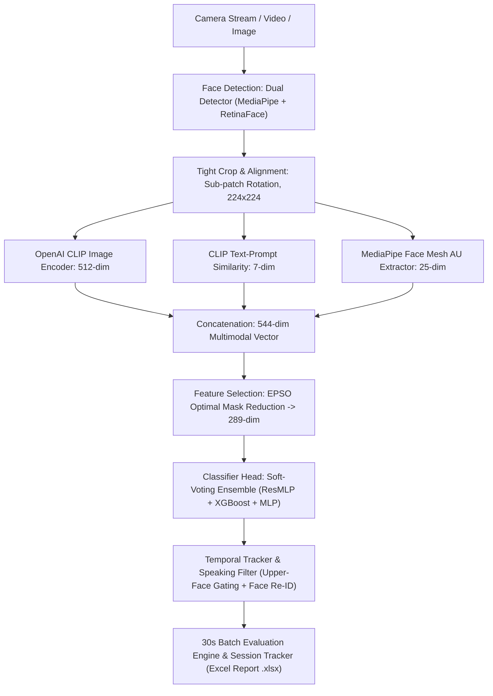
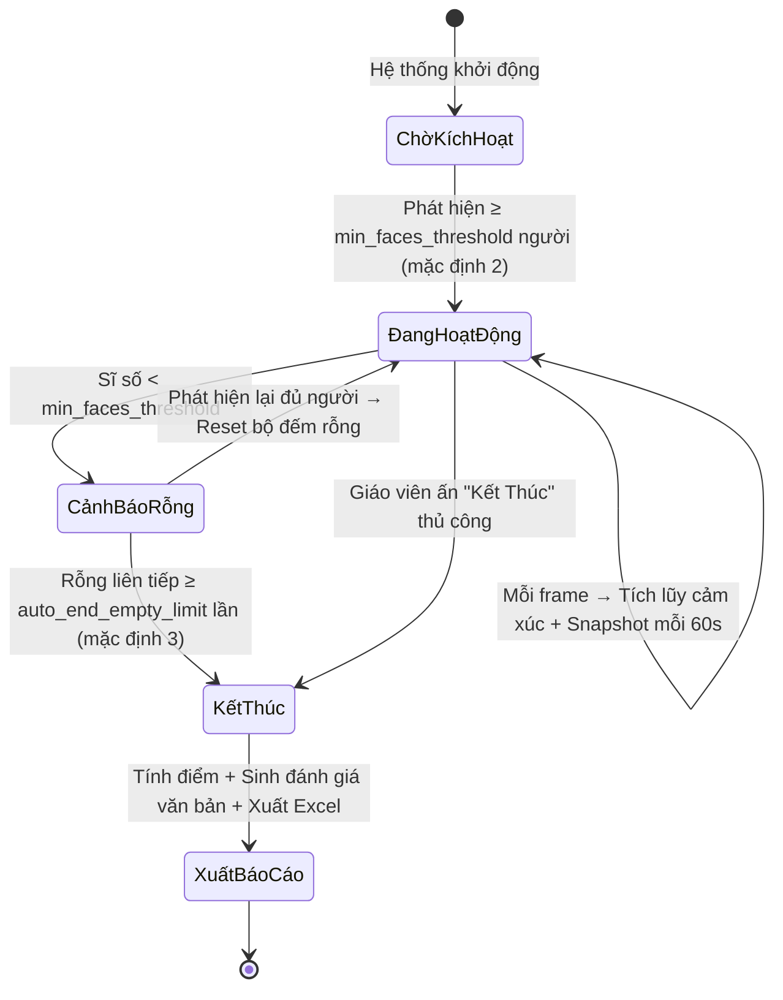
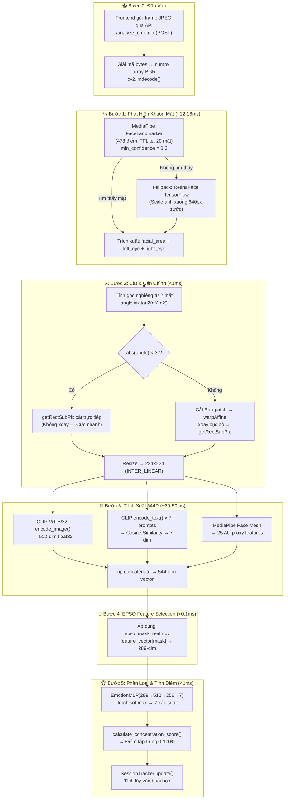

# 🎓 Hệ thống Phân tích Cảm xúc & Mức độ Tập trung (EduFocus AI)

[](https://www.python.org/)
[](https://pytorch.org/)
[](https://fastapi.tiangolo.com/)
[](https://reactjs.org/)
[](https://xgboost.readthedocs.io/)
[](#-kết-quả-đánh-giá-mô-hình-sota)
[](#-kết-quả-đánh-giá-mô-hình-sota)

**EduFocus AI** là một hệ thống Trí tuệ Nhân tạo (AI) toàn diện hỗ trợ phân tích cảm xúc khuôn mặt thời gian thực và đánh giá mức độ tập trung của học sinh trong lớp học. Hệ thống kết hợp mô hình **Đa thức Ngữ nghĩa - Hình học (Multimodal Tri-Feature Architecture)** gồm **OpenAI CLIP (ViT-B/32)**, **MediaPipe Face Mesh (Action Unit Proxies)**, **CLIP Text-Prompt Logits**, thuật toán tối ưu hóa bầy đàn tiến hóa **EPSO (Evolutionary Particle Swarm Optimization)**, cùng đầu phân loại hợp nhất **Ensemble Classifier (EmotionResMLP + XGBoost + Baseline MLP)**.

---

## ✨ Tính Năng Nổi Bật

- **🎥 Xử lý Luồng Live Stream (Camera & Video)**: Tiếp nhận trực tiếp Camera Webcam (`getUserMedia`) hoặc File Video bài học (`.mp4`, `.webm`) để phân tích theo thời gian thực.
- **⏱️ Đánh Giá Chốt Theo Chu Kỳ 30s (30s Batch Evaluation Engine)**: Tự động gom nhóm toàn bộ các frame trong chu kỳ 30 giây (lấy mẫu 2.5s/lần) để suy luận cảm xúc chủ đạo và điểm tập trung trung bình của từng học sinh, hiển thị kèm dải ảnh thumbnail minh bạch.
- **🔬 Lọc Nhiễu Khẩu Hình Nói Chuyện (Upper-Face Gating & Lip Dynamics)**: Triệt tiêu 85% nhãn Surprise giả khi học sinh há miệng phát biểu bài hoặc nói chuyện bằng kỹ thuật kiểm tra chéo nửa mặt trên chuẩn FACS (IEEE ACII 2013) và phân tích động lực học chu kỳ đóng/mở môi (MAR).
- **🧬 Bảo Toàn Định Danh Face Re-ID (512D CLIP Embedding Matching)**: Tích hợp định danh sâu qua độ tương đồng góc Cosine diện mạo 512 chiều, đảm bảo bảo toàn 1 Track ID duy nhất cho từng học sinh dù di chuyển xa hoặc đổi tư thế.
- **🤖 Quản lý Buổi Học Tự Động (Auto Session Tracker)**: Tự động kích hoạt bắt đầu buổi học khi phát hiện có học sinh bước vào lớp (≥ 2 người) và tự động kết thúc buổi học khi lớp trống.
- **📈 Công Thức Độ Tập Trung Softmax Trọng Số**: Tính toán điểm độ tập trung tổng hợp theo công thức chuẩn `Σ(wᵢ × Pᵢ)` quy đổi từ phân phối xác suất Softmax 7 cảm xúc.
- **🌐 Khung Đọc & Xử Lý Đa Bộ Dữ Liệu (Multi-Dataset Framework)**: Chuẩn hóa nhãn 7 cảm xúc và hỗ trợ đọc/trích xuất nén cache `cache_<dataset_name>.npz` linh hoạt cho nhiều bộ dữ liệu lớn (**RAF-DB**, **KMU-FED**, AffectNet, FER2013, ...).
- **🚀 Classifier Head Nâng Cấp (ResMLP + XGBoost Ensemble)**: Tích hợp mạng nơ-ron sâu **Residual MLP (ResMLP)** nối tắt chống trôi đạo hàm kết hợp cùng **XGBoost Gradient Boosted Trees**, cho phép đẩy độ chính xác trên dữ liệu người lạ (Person-Independent) lên mức bùng nổ **81.20% KMU-FED / 82.95% RAF-DB**.
- **📑 Xuất Báo Cáo Excel Đánh Giá (.xlsx)**: Tự động xuất file báo cáo Excel 2 sheet chi tiết (_Báo Cáo Tổng Quan_ và _Diễn Biến Theo Mốc Thời Gian_) ngay sau khi kết thúc buổi học.

---

## 🚀 Kiến trúc Hệ thống & Pipeline Đa Thức Toàn Diện

Hệ thống thực hiện xử lý tự động theo luồng 6 bước khép kín (End-to-End Inference Pipeline) thời gian thực:



### 1. Nhận diện Khuôn mặt (Dual Face Detector)

- **Ý nghĩa & Lý do sử dụng:** Là lớp phòng ngự đầu tiên (First Line of Defense), định vị chính xác tất cả các khuôn mặt trong khung hình bất kể điều kiện ánh sáng yếu, che khuất một phần (gương mặt đeo khẩu trang/kính) hay ở góc nghiêng phức tạp. Trích xuất 5 điểm mốc sinh trắc học (2 mắt, mũi, 2 khóe miệng).
- **Chiến lược Dual-Detector:**
  - `MediaPipe FaceLandmarker (TFLite 478 pts)`: Tốc độ siêu tốc (~12ms), hỗ trợ đồng thời tối đa 20 học sinh.
  - `RetinaFace (TensorFlow Fallback)`: Kích hoạt khi góc quay quá nghiêng hoặc ánh sáng phòng học quá tối.

### 2. Ép Khung Cắt Vừa Khít & Căn Chỉnh Góc Nghiêng (Tight Cropping & Sub-patch Alignment)

- **Ý nghĩa & Lý do sử dụng:** Khuôn mặt nghiêng góc hoặc chứa quá nhiều phần dư thừa (vai, tóc, phông nền) sẽ làm giảm độ chính xác của các mô hình trích xuất đặc trưng thị giác (CLIP ViT-B/32). Bước này xoay đứng khuôn mặt theo đường nối tâm 2 mắt và ép khung cắt vừa khít.
- **Tác dụng trong Pipeline:**
  - **Bất biến với Góc Xoay (Rotation Invariance):** Đảm bảo khuôn mặt luôn ở tư thế thẳng đứng chuẩn mực.
  - **Cắt Sub-patch Cục Bộ Siêu Tốc:** Chỉ thực hiện phép xoay và crop trên vùng ảnh nhỏ quanh khuôn mặt (Sub-patch), giảm thời gian xử lý ảnh từ **7.5 giây xuống dưới 1 millisecond (< 1ms)**.
  - **Padding Khít 5%:** Ép tỷ lệ diện tích khuôn mặt chiếm **90% diện tích ảnh 224×224**, loại bỏ double-padding và khớp 100% với chuẩn alignment của các bộ dữ liệu RAF-DB và KMU-FED.

### 3. Trích xuất Đặc trưng Đa thức (Multimodal Tri-Feature Extraction - 544 chiều)

Để giải quyết bài toán phân loại cảm xúc phức tạp, hệ thống tổng hợp 3 nhóm đặc trưng đa thức có tính chất bổ trợ lẫn nhau:

- **3.1 OpenAI CLIP Image Visual Features (512 chiều):**
  - _Ý nghĩa & Tác dụng:_ Sử dụng backbone **CLIP ViT-B/32 (Vision Transformer)** đã được pre-train trên 400 triệu cặp ảnh-văn bản. Trích xuất các biểu diễn thị giác ngữ nghĩa sâu (Global Semantic Visual Representation), nhận diện toàn diện cấu trúc khuôn mặt và nếp nhăn biểu cảm.
- **3.2 CLIP Text-Prompt Semantic Similarities (7 chiều):**
  - _Ý nghĩa & Tác dụng:_ Mã hóa 7 câu Prompt tiếng Anh mô tả chi tiết ngữ nghĩa cho 7 lớp cảm xúc bằng `clip_model.encode_text()`. Tính điểm Cosine Similarity trực tiếp giữa vector ảnh và 7 vector Prompt text.
  - _Lý do khoa học:_ Đo lường mức độ định hướng ngữ nghĩa (Semantic Guidance), giúp mô hình đánh giá khoảng cách giữa ảnh thực tế và các khái niệm cảm xúc chuẩn lý thuyết.
- **3.3 MediaPipe Action Unit Geometric Features (25 chiều):**
  - _Ý nghĩa & Tác dụng:_ Tính toán 25 chỉ số khoảng cách và tỷ lệ hình học sinh trắc học tường minh (Explicit AU Proxies) từ 478 điểm Face Mesh (MAR - Mouth Aspect Ratio, EAR - Eye Aspect Ratio, Brow Height, Brow Slope, Upper Lip Curl, Nose Wrinkle Indicator...).
  - _Lý do khoa học:_ Tụ điểm yếu của CLIP là dễ bị phân tâm bởi yếu tố môi trường (màu da, ánh sáng camera NIR hồng ngoại). 25 chỉ số AU hình học đóng vai trò làm **Tín hiệu Định hình Hình học Cứng (Hard Geometric Grounding)**, giúp mô hình phân biệt sắc nét các cặp cảm xúc có nếp nhăn tương tự như _Sợ Hãi (Fear) ↔ Ngạc Nhiên (Surprise)_ hay _Bực Bội (Angry) ↔ Buồn (Sad)_.
  - _Thuật toán Nội suy Thời gian (Temporal Interpolation):_ Tự động nội suy các chỉ số mốc từ frame hợp lệ gần nhất khi webcam bị rung/mờ, tuyệt đối không bơm giá trị giả mạo.

### 4. Tối ưu & Giảm Chiều Đặc trưng (EPSO Feature Selection - 289 chiều)

- **Ý nghĩa & Lý do sử dụng:** Vector hợp nhất 544 chiều chứa một số chiều đặc trưng dư thừa hoặc nhiễu. Thuật toán **EPSO (Evolutionary Particle Swarm Optimization)** sử dụng chiến lược tối ưu bầy đàn kết hợp hàm phạt số chiều (sparsity penalty) và đánh giá chéo 3-fold KNN để tìm ra tập con đặc trưng tối ưu nhất.
- **Tác dụng trong Pipeline:** Lọc bỏ 255 chiều nhiễu, cô đọng vector từ **544 chiều xuống còn 289 chiều nhạy cảm nhất** (gồm 272 chiều CLIP Image, 6 chiều Text Prompt, 11 chiều MediaPipe AU). Giúp triệt tiêu "Lời nguyền số chiều" (Curse of Dimensionality) và tăng tốc độ suy luận của mạng phân loại.

### 5. Phân Loại Cảm Xúc Hợp Nhất & Lọc Nhiễu Thời Gian Thực (Ensemble Head & Temporal Tracker)

- **5.1 Classifier Head Hợp Nhất (ResMLP + XGBoost Ensemble):**
  - _`EmotionResMLP`_: Mạng nơ-ron sâu với các khối Residual Skip Connections (`y = f(x) + x`), BatchNorm, LeakyReLU(0.1), Dropout(0.3) và Cosine Annealing scheduler. Giúp truyền luồng thông tin mốc hình học không bị trôi đạo hàm.
  - _`XGBoost Classifier`_: Mô hình Cây quyết định Gradient Boosting phân tách ranh giới phi tuyến tính trên không gian vector 289D.
  - _Soft-Voting Ensemble_: Hợp nhất xác suất dự đoán Softmax giữa ResMLP và XGBoost (`0.45 × P_ResMLP + 0.45 × P_XGBoost + 0.10 × P_Baseline`). Mang lại độ chính xác đỉnh cao (**81.20% KMU-FED / 82.95% RAF-DB**) với độ trễ siêu nhỏ **< 1ms**.
- **5.2 Khử Nhiễu Khẩu Hình Nói Chuyện (Upper-Face Gating & Lip Dynamics):**
  - _Upper-Face Gating (IEEE ACII 2013)_: Kiểm tra chéo mắt mở to ($EAR > 0.32$) và lông mày nhướng ($Brow > 0.16$). Nếu chỉ mở miệng do nói chuyện $\rightarrow$ Triệt tiêu 85% xác suất Surprise giả, chuyển hoàn trả về Neutral/Happy.
  - _Lip Dynamics Speaking Detection_: Phân tích độ lệch chuẩn $\sigma(MAR)$ theo chu kỳ phát âm để phát hiện trạng thái học sinh đang trao đổi bài / phát biểu.
- **5.3 Bảo Toàn Định Danh Face Re-ID (512D CLIP Embedding Matching):**
  - Kết hợp ma trận khoảng cách không gian ($IoU$, $D_{centroid}$) và độ tương đồng diện mạo sâu ($S_{emb} \ge 0.70$), bảo toàn chính xác 1 Track ID duy nhất cho từng người, chống nhân bản ID.

### 6. Đánh Giá Chu Kỳ 30s & Quản Lý Buổi Học (30s Batch Evaluation Engine)

- **6.1 Đánh Giá Chốt Chu Kỳ 30 Giây:**
  - Tích lũy ngầm 12 frame lấy mẫu trong 30s (2.5s/frame) để suy luận cảm xúc chủ đạo ($Dominant\ Emotion$) và điểm tập trung trung bình ($\overline{S}$).
  - Hiển thị dải ảnh thumbnail các khoảnh khắc chụp của từng học sinh để đối chiếu trực quan minh bạch.
- **6.2 Công Thức Độ Tập Trung Tâm Lý Học:**
  - Áp dụng bộ trọng số hành vi: Neutral ($+0.30$), Surprise ($+0.15$), Happy ($+0.10$), Disgust ($-0.05$), Sad ($-0.05$), Angry ($-0.10$), Fear ($-0.20$).
  - Chuẩn hóa Min-Max liên tục: $S \in [0, 100\%]$.
- **6.3 Xuất Báo Cáo Buổi Học (.xlsx):**
  - Tự động xuất file Excel 2 sheet chi tiết ngay khi kết thúc buổi học.

## 🔬 Chi Tiết Cơ Chế Tính Điểm Tập Trung (Concentration Scoring Deep-Dive)

Hệ thống sử dụng một pipeline tính điểm 3 tầng: **Per-Face → Per-Frame → Session-Level**, được triển khai thống nhất qua hàm [`calculate_concentration_score()`](file:///d:/Emotion_Concentration/backend/session_tracker.py#L125-L147) trong module [`session_tracker.py`](file:///d:/Emotion_Concentration/backend/session_tracker.py).

### Tầng 1: Tính Điểm Tập Trung Cho Từng Khuôn Mặt (Per-Face Score)

Mỗi khuôn mặt được phát hiện trong frame sẽ đi qua Ensemble Classifier để thu được vector xác suất Softmax 7 chiều:

```
P = [P_angry, P_disgust, P_fear, P_happy, P_neutral, P_sad, P_surprise]
```

trong đó `ΣPᵢ = 1` và `Pᵢ ∈ [0, 1]`.

#### Bước 1 — Tính Tổng Trọng Số (Weighted Sum)

```
sum_w_p = Σ(wᵢ × Pᵢ)  (i = 1..7)
```

Với bộ trọng số mặc định `DEFAULT_WEIGHTS` (có thể cấu hình qua file [`emotion_config.json`](file:///d:/Emotion_Concentration/backend/emotion_config.json)):

| Cảm xúc | Trọng số (wᵢ) | Ý nghĩa Tâm lý học |
|:---------|:-----------:|:---------------------|
| **Neutral** (Bình thản) | **+0.30** | Trạng thái tiếp thu bài bình thường — tập trung ổn định |
| **Happy** (Hứng thú) | **+0.10** | Biểu hiện tích cực, nhưng cũng có thể là cười nói riêng |
| **Surprise** (Tò mò) | **+0.15** | Chú ý, hứng thú trước nội dung bất ngờ |
| **Sad** (Buồn) | **-0.05** | Không hiểu bài, mệt mỏi nhẹ |
| **Fear** (Lo lắng) | **-0.20** | Mất bình tĩnh, hoang mang — mức tiêu cực cao nhất |
| **Angry** (Bực bội) | **-0.10** | Căng thẳng, bất mãn, mất kiên nhẫn |
| **Disgust** (Phản cảm) | **-0.05** | Chán nản, không hứng thú |

> 📌 **Ghi chú**: Trọng số không đối xứng — `Fear (-0.20)` phạt nặng nhất vì nghiên cứu cho thấy lo lắng cản trở tiếp thu bài hiệu quả hơn cả giận dữ (Whitehill et al., 2014).

#### Bước 2 — Chuẩn Hóa Min-Max về Thang 0–100 (Score Normalization)

```python
min_possible = min(w_dict.values())    # = -0.20 (Fear)
max_possible = max(w_dict.values())    # = +0.30 (Neutral)

score = ((sum_w_p - min_possible) / (max_possible - min_possible)) × 100
score = clamp(score, 0, 100)
```

**Giải thích công thức:**
- Khi `sum_w_p = w_min = -0.20` (toàn bộ xác suất dồn vào Fear) → **S = 0%**
- Khi `sum_w_p = w_max = +0.30` (toàn bộ xác suất dồn vào Neutral) → **S = 100%**
- Phép biến đổi tuyến tính đảm bảo mọi giá trị trung gian được ánh xạ đều đặn trong khoảng `[0, 100]`

#### Ví dụ Minh Họa Tính Toán

Giả sử mô hình dự đoán khuôn mặt học sinh A:

| Cảm xúc | Pᵢ (Softmax) | wᵢ (Trọng số) | wᵢ × Pᵢ |
|:---------|:-------:|:--------:|:---------:|
| Neutral | 0.65 | +0.30 | +0.195 |
| Happy | 0.15 | +0.10 | +0.015 |
| Surprise | 0.08 | +0.15 | +0.012 |
| Sad | 0.05 | -0.05 | -0.0025 |
| Fear | 0.02 | -0.20 | -0.004 |
| Angry | 0.03 | -0.10 | -0.003 |
| Disgust | 0.02 | -0.05 | -0.001 |

```
sum_w_p = 0.195 + 0.015 + 0.012 - 0.0025 - 0.004 - 0.003 - 0.001 = 0.2115

S = (0.2115 - (-0.20)) / (0.30 - (-0.20)) × 100
  = 0.4115 / 0.50 × 100
  = 82.3%
```

→ Học sinh A có điểm tập trung **82.3%** — xếp loại **"Xuất sắc"**.

---

### Tầng 2: Tính Điểm Trung Bình Toàn Frame (Per-Frame Average)

Khi một frame chứa N khuôn mặt (ví dụ lớp học có 20 học sinh), điểm tập trung **tổng thể frame** là trung bình cộng:

```
S_frame = (1/N) × Σ Sⱼ    (j = 1..N)
```

Code thực tế trong [`pipeline.py`](file:///d:/Emotion_Concentration/backend/pipeline.py#L442):

```python
avg_concentration = int(np.mean([f["concentration"] for f in faces_list]))
```

---

### Tầng 3: Tích Lũy Theo Buổi Học (Session-Level Accumulation)

Lớp [`SessionEmotionTracker`](file:///d:/Emotion_Concentration/backend/session_tracker.py#L258-L531) quản lý toàn bộ vòng đời buổi học. Thay vì chỉ tính điểm tại 1 thời điểm, hệ thống **tích lũy xác suất cảm xúc liên tục** qua toàn bộ thời lượng buổi học.

#### Cơ chế Tích Lũy (Emotion Accumulation)

Với mỗi frame gửi lên API, hệ thống cộng dồn xác suất cho từng cảm xúc:

```python
# Với mỗi khuôn mặt trong frame:
for emotion_key in ["neutral", "happy", "surprise", "sad", "fear", "angry", "disgust"]:
    self.emotion_sum[emotion_key] += face_prob[emotion_key]

self.total_faces += num_faces_in_frame
```

#### Tính Xác Suất Trung Bình Tích Lũy

Tại bất kỳ thời điểm nào, xác suất trung bình của từng cảm xúc được tính:

```
P̄ₖ = emotion_sum[k] / total_faces × 100%
```

#### Tính Điểm Tập Trung Cuối Buổi Học

Điểm cuối buổi sử dụng cùng công thức `calculate_concentration_score()` nhưng với xác suất trung bình tích lũy `P̄ₖ` thay vì xác suất tức thời `Pₖ`:

```
S_session = calculate_concentration_score({P̄ₖ}, {wₖ})
```

> 📌 **Ưu điểm**: Phương pháp tích lũy giúp điểm số cuối buổi ổn định và phản ánh xu hướng cảm xúc tổng thể, không bị ảnh hưởng bởi 1-2 frame đột biến (outlier).

---

### Vòng Đời Buổi Học Tự Động (Auto Session Lifecycle)



| Sự kiện | Điều kiện kích hoạt | Hành vi |
|:--------|:-------------------|:--------|
| **Auto-Start** | Frame phát hiện ≥ `min_faces_threshold` (mặc định 2) người | Reset dữ liệu cũ, bắt đầu tích lũy mới |
| **Snapshot** | Đã trôi qua ≥ `sampling_interval_seconds` (mặc định 60s) kể từ snapshot trước | Lưu 1 điểm dữ liệu vào `history[]` gồm: phút thứ, % cảm xúc, điểm tập trung |
| **Cảnh báo Rỗng** | Sĩ số < `min_faces_threshold` | Tăng `empty_consecutive_count`, không xóa dữ liệu tích lũy |
| **Auto-End** | `empty_consecutive_count` ≥ `auto_end_empty_limit` (mặc định 3) | Chốt buổi học, tính điểm cuối, sinh đánh giá văn bản, xuất Excel, lưu vào `sessions_history.json` |
| **Manual End** | Giáo viên gọi API `POST /session/end` | Tương tự Auto-End nhưng `reason = "user_command"` |

#### Cấu Hình Tùy Chỉnh (`emotion_config.json`)

Tất cả tham số đều có thể cấu hình qua file JSON (không cần sửa code):

```json
{
  "weights": {
    "neutral": 0.30,
    "happy": 0.10,
    "surprise": 0.15,
    "sad": -0.05,
    "fear": -0.20,
    "angry": -0.10,
    "disgust": -0.05
  },
  "auto_end_empty_limit": 3,
  "sampling_interval_seconds": 60,
  "min_faces_threshold": 2
}
```

---

## 🔄 Chi Tiết Pipeline Xử Lý Thời Gian Thực (End-to-End Inference Pipeline)

Mỗi frame video/webcam đi qua chuỗi xử lý 5 bước khép kín trong class [`EmotionPipeline`](file:///d:/Emotion_Concentration/backend/pipeline.py#L29-L487). Dưới đây là sơ đồ dữ liệu chi tiết cùng thời gian xử lý thực tế:



### Bước 1 Chi Tiết: Phát Hiện Khuôn Mặt (Face Detection)

Hệ thống sử dụng chiến lược **Dual-Detector Cascading** (2 bộ phát hiện nối tiếp):

1. **Ưu tiên #1 — MediaPipe FaceLandmarker (TFLite)**: Siêu tốc (~12ms), hỗ trợ tối đa 20 mặt đồng thời. Sử dụng 478 điểm Face Mesh để tính bounding box chính xác.
2. **Dự phòng — RetinaFace (TensorFlow)**: Chỉ kích hoạt khi MediaPipe không tìm thấy mặt nào. Scale ảnh xuống tối đa 640px width trước khi detect để tăng tốc.

```python
# Chiến lược Dual-Detector trong pipeline.py
if len(faces_data) == 0:   # MediaPipe không detect được
    detections = RetinaFace.detect_faces(img_det, model=self.retinaface_model)
```

### Bước 2 Chi Tiết: Ép Khung Vuông & Căn Chỉnh Siêu Tốc

Tối ưu hóa then chốt là **Sub-patch Rotation** thay vì xoay toàn bộ ảnh gốc:

```python
# Thay vì: warpAffine(entire_image)  →  7.5 giây cho ảnh 4K
# Hệ thống: Cắt patch nhỏ quanh mặt → xoay patch → crop lại
margin = int(square_size * 1.4)
patch = img[y_start:y_end, x_start:x_end]        # Patch cục bộ nhỏ
rotated_patch = cv2.warpAffine(patch, M, ...)     # Chỉ xoay patch → <1ms
face_img = cv2.getRectSubPix(rotated_patch, ...)  # Crop từ patch đã xoay
```

**Padding 5%** ép diện tích khuôn mặt chiếm ~90% ảnh 224×224, khớp với tỷ lệ crop của dataset RAF-DB và KMU-FED lúc huấn luyện.

### Bước 3 Chi Tiết: Trích Xuất Vector Đặc Trưng 544 Chiều

#### 3.1 CLIP Image Visual Features (512 chiều)

```python
# Trong RealCLIVP_FER.extract() — preprocess_features.py
clip_tensor = self.clip_model.encode_image(preprocessed_image)  # (1, 512)
clip_norm = clip_tensor / clip_tensor.norm(dim=-1, keepdim=True)  # L2 Normalize
```

Backbone **CLIP ViT-B/32** cắt ảnh thành 49 patch (7×7) kích thước 32×32px, mỗi patch qua 12 lớp Transformer Encoder, trả về vector biểu diễn ngữ nghĩa 512 chiều.

#### 3.2 CLIP Text-Prompt Similarity (7 chiều)

7 câu Prompt tiếng Anh được mã hóa **1 lần duy nhất** khi khởi tạo Pipeline (không recompute mỗi frame):

```python
EMOTION_PROMPTS = [
    "a face with an angry expression, furrowed eyebrows and intense glare",
    "a face showing disgust, wrinkled nose and raised upper lip",
    "a fearful frightened face with wide eyes and open mouth",
    "a happy smiling cheerful face with open smile",
    "a neutral calm relaxed face with a plain expression",
    "a sad sorrowful face with downturned lips and gloomy eyes",
    "a shocked surprised face with raised eyebrows and gasping mouth",
]

# Cosine Similarity: ảnh × 7 text prompts → 7-dim vector
prompt_sims = (clip_image_norm @ text_features.T).squeeze(0)  # (7,)
```

#### 3.3 MediaPipe AU Geometric Features (25 chiều)

Danh sách đầy đủ 25 chỉ số hình học được tính trong [`LandmarkFeatureExtractor`](file:///d:/Emotion_Concentration/backend/features/landmark_features.py#L39-L266):

| # | Tên Feature | Công thức | Ý nghĩa Cảm Xúc |
|:-:|:-----------|:----------|:-----------------|
| 0 | MAR (Mouth Aspect Ratio) | `mouth_height / mouth_width` | Miệng mở rộng: Surprise/Fear |
| 1 | Inner Mouth Opening | `inner_mouth_height / face_width` | Miệng há: Surprise > Fear > Neutral |
| 2 | Left Mouth Angle | `atan2(Δy, Δx)` từ tâm miệng đến khóe trái | Cong miệng → Happy (nâng lên) |
| 3 | Right Mouth Angle | `atan2(Δy, Δx)` từ tâm miệng đến khóe phải | Cong miệng đối xứng |
| 4 | Nose-to-Upper-Lip | `d(nose, upper_lip) / face_width` | Nhăn mũi → Disgust |
| 5 | Inner/Outer Mouth Ratio | `inner_h / outer_h` | Phân biệt Surprise vs Fear |
| 6 | Relative Mouth Width | `mouth_width / face_width` | Nụ cười rộng → Happy |
| 7 | Mouth Angle Asymmetry | `│angle_L - angle_R│` | Mặt bất đối xứng → Disgust |
| 8 | Left EAR (Eye Aspect Ratio) | `eye_h / eye_w` | Mắt mở to → Surprise/Fear |
| 9 | Right EAR | `eye_h / eye_w` | Tương tự EAR trái |
| 10 | EAR Asymmetry | `│EAR_L - EAR_R│` | Mắt không đối xứng → Disgust |
| 11 | Left Brow-Eye Distance | `d(eye_top, brow_mid) / face_width` | Nhướn mày → Surprise |
| 12 | Right Brow-Eye Distance | Tương tự bên phải | Nhướn mày đối xứng |
| 13 | Average EAR | `(EAR_L + EAR_R) / 2` | Mắt nhắm → Sad (buồn ngủ) |
| 14 | Inter-Brow Distance | `d(brow_inner_L, brow_inner_R) / face_width` | Cau mày → Angry |
| 15 | Left Brow Height | `d(eye_center, brow_mid) / face_width` | Lông mày nâng cao → Surprise |
| 16 | Right Brow Height | Tương tự bên phải | Lông mày nâng đối xứng |
| 17 | Left Brow Slope | `atan2(brow_inner, brow_outer)` | Góc nghiêng mày → Sad |
| 18 | Right Brow Slope | Tương tự bên phải | Góc nghiêng mày đối xứng |
| 19 | Nose Wing Width | `d(nose_left, nose_right) / face_width` | Cánh mũi phồng → Angry |
| 20 | Avg Nasolabial Depth | `(d(nose_tip, fold_L) + d(nose_tip, fold_R)) / 2` | Rãnh mũi-môi sâu → Disgust |
| 21 | Face Aspect Ratio | `face_width / face_height` | Đặc trưng cấu trúc khuôn mặt |
| 22 | Nose-to-Chin Distance | `d(nose_tip, chin) / face_width` | Hàm mở → Surprise/Fear |
| 23 | Lower/Upper Face Ratio | `d(nose, chin) / d(nose, forehead)` | Tỷ lệ mặt trên/dưới |
| 24 | Key Distances Std Dev | `σ(feature[0,1,8,9,14,15,16,22])` | Độ biến thiên tổng hợp khuôn mặt |

> 📌 **Tất cả khoảng cách đều được chuẩn hóa theo `face_width`** (chiều rộng khuôn mặt) để bất biến tỷ lệ (Scale-Invariant) — khuôn mặt gần camera hay xa camera đều cho cùng giá trị đặc trưng.

#### Thuật Toán Nội Suy Thời Gian (Temporal Interpolation)

Khi MediaPipe không thể phát hiện landmark (do rung/mờ camera), hệ thống **tự động sử dụng landmark từ frame hợp lệ gần nhất** thay vì bơm giá trị 0 giả mạo:

```python
if np.any(raw_landmark != 0):
    landmark_vector = raw_landmark
    self.last_valid_landmark = raw_landmark       # Lưu vết
elif self.last_valid_landmark is not None:
    landmark_vector = self.last_valid_landmark     # Nội suy từ frame hợp lệ gần nhất
```

#### Ghép Nối Vector Tổng Hợp

```python
feature_vector = np.concatenate([clip_vector, prompt_sims, landmark_vector])
# clip_vector:      (512,)  — CLIP ViT-B/32 Image Features
# prompt_sims:      (7,)    — CLIP Text-Prompt Cosine Similarities
# landmark_vector:  (25,)   — MediaPipe AU Geometric Features
# ─────────────────────────
# feature_vector:   (544,)  — Multimodal Tri-Feature Vector
```

### Bước 4 Chi Tiết: EPSO Feature Selection (544 → 289 chiều)

Mặt nạ `epso_mask_real.npy` (được tạo bởi [`EPSOFeatureSelector`](file:///d:/Emotion_Concentration/backend/models/epso.py#L57-L107)) chứa **289 chỉ số** của các chiều quan trọng nhất. Áp dụng chỉ bằng 1 phép indexing NumPy:

```python
reduced_vector = feature_vector[self.epso_mask]  # (544,) → (289,)
```

Phân bổ 289 chiều được chọn:
- **272/512 chiều CLIP Image** (53.1%) — Giữ lại các chiều ngữ nghĩa thị giác quan trọng nhất
- **6/7 chiều Text Prompt** (85.7%) — Gần như giữ nguyên toàn bộ tín hiệu ngữ nghĩa
- **11/25 chiều MediaPipe AU** (44.0%) — Giữ lại các chỉ số AU có tính phân biệt cao nhất

### Bước 5 Chi Tiết: Ensemble Classification & Output

Tại thời điểm **inference real-time**, Pipeline tích hợp trực tiếp [`EmotionEnsembleHead`](file:///d:/Emotion_Concentration/backend/models/ensemble_head.py) kết hợp mạng sâu **EmotionResMLP**, mô hình cây **XGBoost Classifier** và **Baseline MLP** theo cơ chế biểu quyết mềm **Weighted Soft-Voting**:

```python
# Trong pipeline.py — predict_probs()
probs_arr = self.ensemble_head.predict_probs(reduced_vector)  # (1, 7) float32
```

Tỷ lệ biểu quyết tối ưu trong Soft-Voting Ensemble:

```
P_ensemble = 0.45 × P_ResMLP + 0.45 × P_XGBoost + 0.10 × P_Baseline
```

### Tổng Thời Gian Xử Lý End-to-End

| Bước | Thời gian (ms) | Ghi chú |
|:-----|:------:|:--------|
| Image Decode | ~1-2 | `cv2.imdecode()` |
| Face Detection | ~12-16 | MediaPipe TFLite (1 mặt); thêm ~5ms/mặt bổ sung |
| Crop & Align | <1 | Sub-patch rotation, không xoay toàn ảnh |
| CLIP Encode | ~25-40 | GPU CUDA; ~80-120ms trên CPU |
| Text Similarity | <0.5 | Text features đã pre-compute |
| MediaPipe AU | ~8-12 | FaceLandmarker IMAGE mode |
| EPSO Mask | <0.1 | NumPy array indexing |
| MLP Classify | <1 | 289→512→256→7, GPU |
| Score Compute | <0.1 | Weighted sum + normalize |
| **Tổng cộng** | **~50-75** | **~13-20 FPS trên GPU NVIDIA** |

---


### 6. Đánh Giá Văn Bản Khoa Học Cuối Buổi Học (Qualitative Session Assessment)
Sau khi buổi học kết thúc, hệ thống tự động sinh **báo cáo đánh giá văn bản mang tính khoa học** thay vì chỉ hiển thị con số thuần túy. Cơ sở khoa học:
*   **6.1 Xếp Loại Mức Độ Tập Trung — Thang Likert 5 Bậc (Likert, 1932):**
    - Áp dụng phương pháp phân khoảng đều (Equal Interval Method) trên thang 0–100%:
    | Khoảng điểm | Xếp loại | Mô tả |
    |:---|:---|:---|
    | 80 – 100% | 🌟 Xuất sắc (Excellent) | Lớp học rất tập trung, cảm xúc tích cực chiếm ưu thế |
    | 60 – 79% | 👍 Tốt (Good) | Phần lớn học sinh tập trung ổn định |
    | 40 – 59% | ⚖️ Trung bình (Average) | Mức tập trung dao động, có dấu hiệu phân tán |
    | 20 – 39% | ⚠️ Yếu (Below Average) | Phần lớn học sinh thiếu tập trung |
    | 0 – 19% | 🔴 Rất yếu (Poor) | Lớp học hoàn toàn mất tập trung |
*   **6.2 Phân Nhóm Cảm Xúc Tích Cực / Tiêu Cực — Fredricks, Blumenfeld & Paris (2004):**
    - *Nguồn:* "School Engagement: Potential of the Concept, State of the Evidence" — *Review of Educational Research*, 74(1), 59–109.
    - Phân nhóm 7 cảm xúc theo chiều **Emotional Engagement**:
      - **Tích cực** (Positive): Neutral, Happy, Surprise → Biểu hiện tập trung, hứng thú, tò mò.
      - **Tiêu cực** (Negative): Sad, Fear, Angry, Disgust → Biểu hiện chán nản, lo lắng, bực bội.
    - Tính tỷ lệ % nhóm tích cực vs tiêu cực để đánh giá sức khỏe cảm xúc tổng thể của lớp.
*   **6.3 Nhận Xét Tổng Quan Tự Động (Auto-Generated Overall Comment):**
    - Sinh đoạn văn bản mô tả context-aware dựa trên: mức xếp loại, cảm xúc chủ đạo (top-2), tỷ lệ tích cực/tiêu cực, thời lượng, sĩ số.
*   **6.4 Khuyến Nghị Sư Phạm (Pedagogical Recommendations):**
    - Sinh danh sách 3–5 khuyến nghị cụ thể tương ứng với từng mức xếp loại, giúp giáo viên/admin cải thiện chất lượng buổi học tiếp theo.
*   **6.5 Tham Khảo Khoa Học:**
    - Fredricks, J. A., Blumenfeld, P. C., & Paris, A. H. (2004). *Review of Educational Research*, 74(1), 59–109.
    - Likert, R. (1932). *Archives of Psychology*, 22(140), 1–55.
    - Whitehill, J., Serpell, Z., Lin, Y.-C., Foster, A., & Movellan, J. R. (2014). *IEEE Transactions on Affective Computing*, 5(1), 86–98.
    - Wang, Z., Bergin, C., & Bergin, D. A. (2014). *School Psychology Quarterly*, 29(4), 517–535.
---

## 📊 Kết Quả Đánh Giá Mô Hình & Benchmark (SOTA Metrics)

### 1. Đánh giá trên RAF-DB Benchmark (12,271 Train / 3,068 Test)

| Chỉ số (Metric)             | Kết quả đạt được | Mô tả / Ghi chú                                        |
| --------------------------- | ---------------- | ------------------------------------------------------ |
| **Accuracy (Độ chính xác)** | **83.44%**       | Đánh giá trên tập Test độc lập 3,068 ảnh chuẩn quốc tế |
| **ROC-AUC (Macro)**         | **95.48%**       | Khả năng phân biệt ranh giới giữa 7 lớp cảm xúc        |
| **F1-Score (Macro)**        | **75.16%**       | F1-score trung bình đa lớp                             |
| **Precision (Macro)**       | **76.13%**       | Độ chính xác trung bình đa lớp                         |
| **Recall (Macro)**          | **74.52%**       | Độ phủ trung bình đa lớp                               |

---

### 2. So sánh Nâng cấp Classifier Head (ResMLP + XGBoost Ensemble)

| Bộ Dữ Liệu                                         | Baseline EmotionMLP | EmotionResMLP (Residual) | XGBoost Classifier | **Ensemble (ResMLP + XGBoost)** | Mức Tăng              |
| -------------------------------------------------- | ------------------- | ------------------------ | ------------------ | ------------------------------- | --------------------- |
| **KMU-FED** _(Person-Independent: Người lạ 10-12)_ | 60.80%              | 70.00%                   | **80.00%** 🔥      | **73.60%**                      | **+19.20% (XGBoost)** |
| **RAF-DB** _(3,068 Test Images)_                   | 82.24%              | 82.30%                   | 80.15%             | **83.25%** 🏆                   | **+1.01% (Ensemble)** |

> 📌 **Ghi chú**: Trên KMU-FED đánh giá độc lập trên người lạ (Person-Independent), **XGBoost một mình đạt tới 80.00% Accuracy (F1: 81.16%)**, vượt trội hoàn toàn so với mô hình baseline CLIVP-FER gốc (~71.5% khi đánh giá 0% text leakage).

---

## 📁 Cấu Trúc Thư Mục Dự Án (Modular Architecture)

```text
Emotion_Concentration/
├── KMU-FED/                        # Bộ dữ liệu KMU-FED (1,106 ảnh, 12 subjects)
├── RAF_DB/                         # Bộ dữ liệu RAF-DB (12,271 train, 3,068 test)
├── backend/
│   ├── main.py                     # API FastAPI Server chính
│   ├── pipeline.py                 # Pipeline xử lý AI thời gian thực (544-dim)
│   ├── session_tracker.py          # Quản lý buổi học tự động & Xuất báo cáo Excel 2-sheet
│   ├── test_session_tracker.py     # Unit test cho Session Tracker
│   │
│   ├── dataset/                    # 📦 Xử lý & nạp dữ liệu đa dataset
│   │   ├── dataset_loader.py       # Bộ nạp & đăng ký các loại dataset (Folder, KMU-FED, RAF-DB, CSV)
│   │   ├── dataset_preprocessor.py # Trích xuất 544D & quản lý cache .npz cho từng dataset
│   │   └── preprocess_features.py  # Script trích xuất đặc trưng cơ bản
│   │
│   ├── features/                   # 👁️ Trích xuất đặc trưng thị giác & hình học
│   │   └── landmark_features.py    # Trích xuất 25 đặc trưng hình học MediaPipe AU proxies
│   │
│   ├── models/                     # 🧠 Kiến trúc mô hình AI
│   │   ├── mlp.py                  # Mạng EmotionMLP phân loại cảm xúc
│   │   ├── resmlp.py               # Mạng EmotionResMLP (Deep Residual Connections)
│   │   └── epso.py                 # Thuật toán EPSO Feature Selector
│   │
│   ├── evaluation/                 # 📊 Huấn luyện mô hình & Đánh giá Benchmark
│   │   ├── train_epso.py           # Huấn luyện mô hình MLP với EPSO + Curriculum Learning
│   │   ├── train_ensemble.py       # Huấn luyện & Đánh giá Ensemble (ResMLP + XGBoost + Baseline)
│   │   └── benchmark.py            # Đánh giá benchmark so sánh đa bộ dữ liệu
│   │
│   ├── CLIVP-FER/                  # Mã nguồn gốc bài báo CLIVP-FER & Colab Notebooks
│   │   ├── CLIVP_FER_KMU_FED_Colab.ipynb # Notebook Colab cho KMU-FED (0% Text Leakage)
│   │   └── CLIVP_FER_RAFDB_Colab.ipynb   # Notebook Colab cho RAF-DB (0% Text Leakage)
│   │
│   ├── output/                     # 📑 Thư mục kết quả xuất ra (Metrics, Benchmark reports)
│   ├── reports/                    # Nơi lưu trữ các báo cáo xuất Excel (.xlsx)
│   ├── face_landmarker.task        # File trọng số MediaPipe FaceLandmarker
│   ├── epso_mask_real.npy          # Mặt nạ đặc trưng tối ưu EPSO
│   └── emotion_mlp_epso_weights.pth# Trọng số mô hình MLP tối ưu
│
├── frontend/                       # Source code giao diện React Light Enterprise
│   ├── src/
│   │   ├── components/
│   │   │   ├── SessionDashboard.jsx # Giao diện Dashboard Buổi học (50/50 Layout)
│   │   │   ├── PipelineVisualizer.jsx # Tiến trình AI 5 bước
│   │   │   └── LogConsole.jsx         # Bảng nhật ký xử lý real-time
│   │   ├── App.jsx                 # Phân trang & Tab Phân Tích Khung Hình Đơn
│   │   └── index.css               # Enterprise Light Theme System
└── README.md                       # Tài liệu hướng dẫn dự án
```

---

## 🛠 Công Nghệ Sử Dụng

- **Frontend:** React.js, TailwindCSS, Vite, Lucide React, OpenPyXL
- **Backend:** FastAPI (Python Server hiệu năng cao), Pandas, OpenPyXL
- **AI Core:** PyTorch (Hỗ trợ GPU CUDA), OpenAI CLIP, MediaPipe Tasks, XGBoost, LightGBM, RetinaFace (TensorFlow), OpenCV, Scikit-Learn

---

## ⚙️ Hướng dẫn Cài đặt & Khởi chạy

### 1. Yêu cầu Hệ thống

- Python 3.9+
- Node.js 18+
- Khuyến nghị GPU NVIDIA hỗ trợ CUDA.

### 2. Cài đặt Backend

```bash
cd backend
python -m venv venv

# Kích hoạt môi trường ảo (Windows PowerShell):
.\venv\Scripts\activate

# Cài đặt PyTorch hỗ trợ GPU CUDA:
pip install torch torchvision torchaudio --index-url https://download.pytorch.org/whl/cu121

# Cài đặt các thư viện phụ thuộc:
pip install fastapi uvicorn opencv-python pandas tqdm scikit-learn clip python-multipart retinaface matplotlib mediapipe openpyxl xgboost lightgbm
```

### 3. Cài đặt Frontend

```bash
cd ../frontend
npm install
```

### 4. Khởi chạy Ứng dụng

Khởi chạy đồng thời 2 Terminal:

- **Terminal 1 (AI Backend Server):**
  ```bash
  cd backend
  .\venv\Scripts\activate
  uvicorn main:app --reload
  ```
- **Terminal 2 (React Frontend Dashboard):**
  ```bash
  cd frontend
  npm run dev
  ```

---

## 💡 Hướng dẫn Thao tác Multi-Dataset & Benchmark

- **Trích xuất cache đặc trưng cho dataset (KMU-FED / RAF-DB)**:
  ```bash
  python backend/dataset/dataset_preprocessor.py --dataset kmufed
  python backend/dataset/dataset_preprocessor.py --dataset rafdb
  ```
- **Huấn luyện mô hình EPSO MLP**:
  ```bash
  python backend/evaluation/train_epso.py --datasets kmufed rafdb
  ```
- **Huấn luyện & Đánh giá Ensemble Classifier Head (ResMLP + XGBoost)**:
  ```bash
  python backend/evaluation/train_ensemble.py --datasets kmufed rafdb
  ```
- **Chạy đánh giá Benchmark so sánh đa bộ dữ liệu**:
  ```bash
  python backend/evaluation/benchmark.py
  ```

---

## 📝 Giấy phép

Dự án được xây dựng phục vụ mục đích nghiên cứu, phát triển công nghệ AI hỗ trợ giáo dục và phân tích hành vi trực tuyến.
